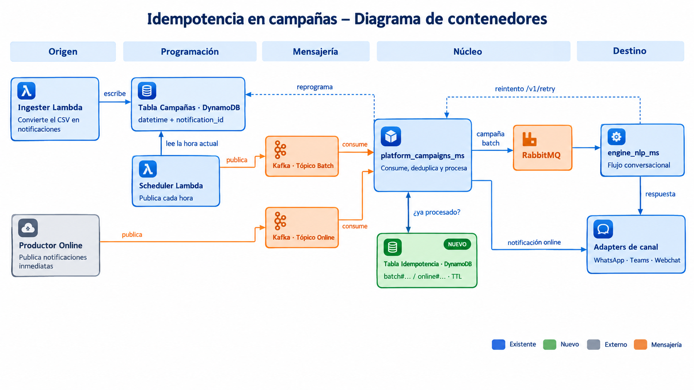

# Estrategia de idempotencia en el procesamiento de campañas

- **Componentes:** `ingester_Lambda/`, `scheduler_Lambda/`, `platform_campaigns_ms/`, `engine_nlp_ms/`
- **Alcance:** los consumidores Kafka de `platform_campaigns_ms` (batch y online)
- **Fecha:** 2026-10-15

## 1. Contexto

```
ingester_Lambda ──(DynamoDB)──> scheduler_Lambda ──(Kafka)──> platform_campaigns_ms ──(RabbitMQ)──> engine_nlp_ms
                                       ▲                              │
                                       └──── nuevo ítem en DynamoDB ──┘  (reprogramación por horario / reintento)
```



- **ingester_Lambda:** convierte cada fila del CSV en un ítem de DynamoDB por cada combinación **día × hora** programada. Cada ítem recibe su propio `notification_id`. La clave de la tabla es `datetime + notification_id`, así que **cada ítem es un intento de entrega**.
- **scheduler_Lambda:** cada hora consulta los ítems de esa hora y los publica en Kafka.
- **platform_campaigns_ms:** consume el evento y lo envía al engine o lo reprograma.
- **Reprogramación y reintentos:** ni la reprogramación por estar fuera de horario ni el reintento (`POST /v1/retry`, que llama `engine_nlp_ms`) publican directamente. Ambos crean un **ítem nuevo** en DynamoDB con el **mismo `notification_id`** y **otro `datetime`**, y el scheduler lo publica cuando llega esa hora.

## 2. Problema

Un mismo evento puede llegar más de una vez al consumidor, y hoy se procesaría cada vez. El cliente recibiría el mensaje duplicado. Las causas son:

- El scheduler se ejecuta más de una vez dentro de la misma hora o la Lambda se reintenta. Como consulta por partición horaria, vuelve a publicar todos los ítems de esa hora.
- El producer de Kafka reintenta un envío.
- El consumer se rebalancea o el pod se reinicia antes del commit del offset.

## 3. Clave de idempotencia

**Clave:** `datetime + notification_id`, la misma clave del ítem que originó el evento. Se recomienda agregar `retries` como protección adicional.

| Caso | `notification_id` | `datetime` | Resultado |
|---|---|---|---|
| Republicación del mismo ítem (scheduler, Kafka, rebalanceo) | igual | igual | Duplicado, no se procesa |
| Reprogramación por horario | igual | nuevo | Se procesa |
| Reintento | igual | nuevo | Se procesa |

**Por qué no basta con `notification_id`:** las reprogramaciones y los reintentos reutilizan el mismo `notification_id`, así que deduplicar solo por él los descartaría.

**Por qué agregar `retries`:** cubre el caso en que el intervalo de reintento esté configurado en 0 y el reintento caiga en el mismo `datetime`.

Todos estos datos ya viajan en el evento, así que **no hay que cambiar el contrato**.

## 4. Estrategia

1. **Registro de eventos procesados en DynamoDB.** Se crea una tabla dedicada con expiración automática (TTL).
   - No sirve un caché en memoria: el MS corre con varias réplicas y la memoria se pierde al reiniciar.
   - No se reutiliza la tabla de campañas para no mezclar estos registros con los ítems que consulta el scheduler.
2. **Reserva atómica antes de procesar.** El consumidor intenta registrar la clave con estado *en proceso*.
   - Si la clave ya existe, el evento se descarta como duplicado y se registra en el log y en una métrica.
   - Si dos pods reciben el mismo evento a la vez, solo uno logra registrarlo.
3. **Cierre del registro.** Al terminar, el registro queda como *completado*. Si el procesamiento falla, queda como *fallido*, para que una nueva publicación pueda reprocesarlo.
4. **Tiempo máximo en proceso (lease).** Si un pod muere a mitad del procesamiento, la reserva se libera después de unos minutos.
5. **Vigencia del registro.** Debe durar al menos lo mismo que la vigencia de la campaña (`days_to_expire`) más un margen.
6. **Si DynamoDB no está disponible.** Se recomienda procesar igual (fail-open) y disparar una alarma. Es preferible arriesgar un duplicado que perder la campaña, porque hoy el consumer hace ack aunque haya error. La política debe ser configurable.
7. **Flujo online.** Se aplica la misma estrategia, con estas diferencias:
   - **Origen:** el evento lo publica un sistema externo al flujo de campañas. No pasa por el ingester, el scheduler ni DynamoDB, y se entrega directo al adapter del canal, sin pasar por el engine.
   - **Clave:** basta con el `notification_id`, que es obligatorio y se valida como UUID. En este flujo no hay reprogramación ni reintentos que lo reutilicen. Se le antepone el prefijo `online#` para no chocar con las claves batch en la misma tabla.
   - **Vigencia más corta:** la entrega es inmediata, así que basta con conservar el registro unas horas o días.
   - **Acuerdo con el productor:** el productor debe generar un `notification_id` único por notificación y **reutilizar el mismo id cuando reintenta el envío**. Si genera un id nuevo en cada intento, los duplicados no se pueden detectar.

### 4.1 Solución unificada batch + online

Los dos flujos comparten **un solo mecanismo**: la misma tabla y el mismo caso de uso de idempotencia. Solo cambia cómo se arma la clave.

- **Cómo se distinguen:** por el **consumidor que recibe el evento**, es decir, por el tópico. No se usa el contenido del mensaje. Cada caso de uso (batch u online) arma su clave con un prefijo de flujo.

| Flujo | Clave | Vigencia del registro |
|---|---|---|
| Batch | `batch#notification_id#datetime#retries` | Días (según la vigencia de la campaña) |
| Online | `online#notification_id` | Horas o pocos días |

- **Para qué sirve el prefijo:**
  - separa los dos espacios de claves en la tabla;
  - permite aplicar una vigencia distinta por flujo;
  - facilita las métricas y la búsqueda en logs por flujo (por ejemplo, duplicados batch frente a online).
- **Atributo de flujo:** el registro guarda además el flujo (`batch`/`online`) como atributo, para monitoreo.

**Ubicación en la arquitectura:** un puerto de dominio para el registro de idempotencia, un caso de uso que envuelve el procesamiento actual y un adapter en el módulo `dynamo-db` existente.

## 5. Garantías y límites

- **Se garantiza** que un mismo intento de entrega se procese **una sola vez** en `platform_campaigns_ms`, aunque haya varias réplicas, reinicios o republicaciones.
- **Ventana residual:** si el envío al engine sale bien pero el pod muere antes de marcar el registro como completado, el evento puede reprocesarse cuando venza el lease. Cerrar esa ventana requeriría deduplicar también en `engine_nlp_ms`. Queda fuera de este alcance.
- **El endpoint `/v1/retry` ya es idempotente por construcción:** dos llamadas sobre el mismo ítem calculan la misma fecha y escriben sobre el mismo ítem nuevo.

## 6. Riesgo no cubierto: reprocesamiento del mismo archivo en el ingester

El ingester genera `campaign_id` y `notification_id` aleatorios. Si **el mismo archivo se procesa dos veces**, se crean ids nuevos para las mismas filas. Esto puede pasar por un evento S3 duplicado, por un reintento de la Lambda o porque alguien vuelve a subir el archivo. Para el consumidor serían eventos distintos, y **la idempotencia del MS no lo detectaría**.

Opciones para cubrirlo en el origen (por evaluar):

- **Ids deterministas:** derivar el `notification_id` de datos estables (archivo, usuario, app, nodo, fecha y hora). Si el archivo se reprocesa, se sobrescriben los mismos ítems en vez de duplicarse.
- **Control de archivos procesados:** registrar los archivos ya ingeridos y descartar los repetidos.

## 7. Observaciones complementarias

- **Frecuencia del scheduler:** confirmarla. Como consulta por hora, cada ejecución extra dentro de la misma hora republica todo lo de esa hora.
- **Confirmación de offsets en el consumer:** hoy se hace fuera de orden, lo que puede causar pérdida de mensajes, no duplicados. Revisarlo por separado.

## 8. Validación

- **Escenarios a cubrir:**
  - evento nuevo: se procesa;
  - duplicado: se descarta;
  - reprogramación y reintento: se procesan;
  - registro fallido: se reprocesa;
  - lease vencido: se reprocesa;
  - DynamoDB caído: se aplica la política configurada.
- **Prueba integral:** publicar el mismo evento varias veces y desde varios consumidores en paralelo, y verificar que el engine recibe un solo mensaje.
