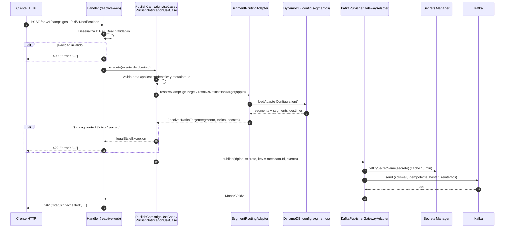

# queuer_ms — Kafka REST Proxy (campañas y notificaciones)

Documentación de los endpoints agregados en la rama `feature/7931497-queuer-ms-kafka-rest-proxy` (último commit revisado: `cecc318af`).

La rama convierte a `queuer_ms` en un **proxy HTTP → Kafka**: recibe eventos de campañas y de notificaciones por REST, resuelve el segmento del `applicationIdentifier` contra la configuración de segmentos y destinos en DynamoDB y publica el evento en el tópico Kafka de ese segmento, con las credenciales del secreto de AWS Secrets Manager configurado para él.

## Endpoints nuevos

| Método | Ruta | Descripción | Tópico destino (clave en `segments_destinies.<segmento>.kafka`) | Doc |
|---|---|---|---|---|
| `POST` | `/api/v1/campaigns` | Publica un evento de campaña masiva | `campaigns` | [POST-api-v1-campaigns.md](endpoints/POST-api-v1-campaigns.md) |
| `POST` | `/api/v1/notifications` | Publica un evento de notificación en línea | `notifications` | [POST-api-v1-notifications.md](endpoints/POST-api-v1-notifications.md) |

El endpoint existente `POST /queuer` (operación `VariableSetter`) no cambia de comportamiento; solo se reescribió el `switch` como un `if`.

## Índice

- [Endpoint `POST /api/v1/campaigns`](endpoints/POST-api-v1-campaigns.md)
- [Endpoint `POST /api/v1/notifications`](endpoints/POST-api-v1-notifications.md)
- [Publicación en Kafka: enrutamiento, secretos, resiliencia y health](publicacion-kafka.md)
- [Guía de pruebas y casos de prueba](pruebas.md)
- [Observaciones de la revisión](observaciones.md)
- [Backlog de pruebas](../backlog/README.md)

## Backlog de pruebas

El trabajo para automatizar estos casos en las pruebas de despliegue de `queuer_ms` (`deployment/acceptanceTest` y `deployment/smokeTest`, Karate) está en [`../backlog/`](../backlog/README.md), vault de Obsidian en modo agente. La cola de ejecución está en [`dashboards/ready-queue.md`](../backlog/dashboards/ready-queue.md).

| Tarjeta | Qué cubre |
|---|---|
| [T-001](../backlog/tasks/T-001-parametrizar-karate-config.md) | `baseUrl`, `kafkaReadTimeout` y `kafkaAppId` en los `karate-config.js` |
| [T-002](../backlog/tasks/T-002-verificar-exposicion-rutas.md) | Exposición de `/api/v1/*` por VirtualService y Cognito en `dev` |
| [T-003](../backlog/tasks/T-003-datos-prueba-kafka-dev.md) | Datos de prueba Kafka en `dev` (appId, segmento, secreto, tópicos) |
| [T-004](../backlog/tasks/T-004-aceptacion-campaigns.md) | Aceptación de `POST /api/v1/campaigns` |
| [T-005](../backlog/tasks/T-005-aceptacion-notifications.md) | Aceptación de `POST /api/v1/notifications` |
| [T-006](../backlog/tasks/T-006-humo-endpoints-kafka.md) | Humo de las dos rutas sin publicar en Kafka |
| [T-007](../backlog/tasks/T-007-evidencias-y-trazabilidad.md) | Ejecución en `dev`, evidencias y trazabilidad |

El detalle de qué escenario cubre cada caso está en [pruebas.md — Automatización en Karate](pruebas.md#automatización-en-karate).

## Flujo general

> El `202 Accepted` se devuelve **después** de que Kafka confirma la escritura (`acks=all`), no antes. La respuesta es síncrona respecto a la publicación.

## Componentes agregados

| Capa | Módulo | Clase | Rol |
|---|---|---|---|
| Entry point | `reactive-web` | `RouterRest` | Registra las rutas `/api/v1/campaigns` y `/api/v1/notifications` |
| Entry point | `reactive-web` | `Handler#handleCampaignRequest` / `#handleNotificationRequest` | Valida el payload, mapea a dominio y traduce errores a HTTP |
| Entry point | `reactive-web` | `dto/kafka/*` | DTOs de entrada con Bean Validation |
| Dominio | `model` | `CampaignEvent`, `NotificationEvent`, `ResolvedKafkaTarget` | Modelos de dominio |
| Dominio | `model` | `SegmentRoutingGateway`, `KafkaPublisherGateway` | Puertos |
| Dominio | `usecase` | `PublishCampaignUseCase`, `PublishNotificationUseCase` | Orquestan resolución de destino y publicación |
| Driven adapter | `dynamo-db` | `SegmentRoutingAdapter` | Resuelve segmento → tópico + secreto |
| Driven adapter | `kafka-producer` (nuevo) | `KafkaPublisherGatewayAdapter`, `KafkaProducerConfig`, `ResilientKafkaProducer`, `KafkaHealthIndicator` | Publicación resiliente y health |
| Helper | `secret-manager` (nuevo) | `KafkaSecretProvider`, `KafkaProps` | Lectura y cache de secretos Kafka |
| App | `app-service` | `ReactiveCommonsConfig` | Registra el bean `ResponseValidator` |
